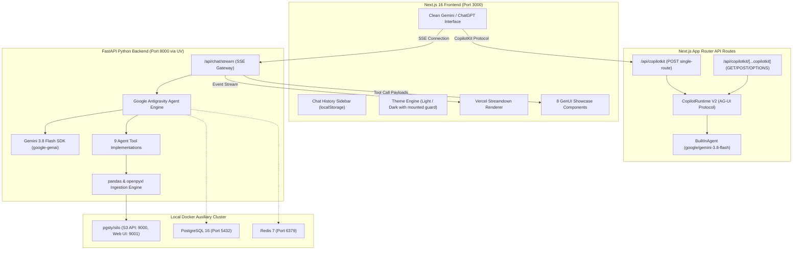
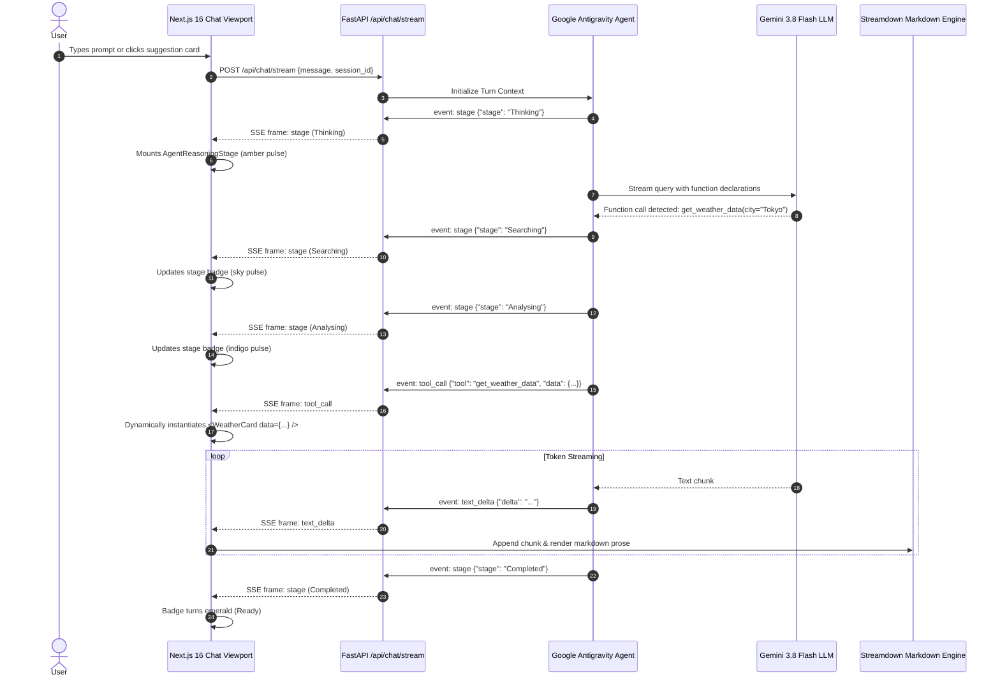
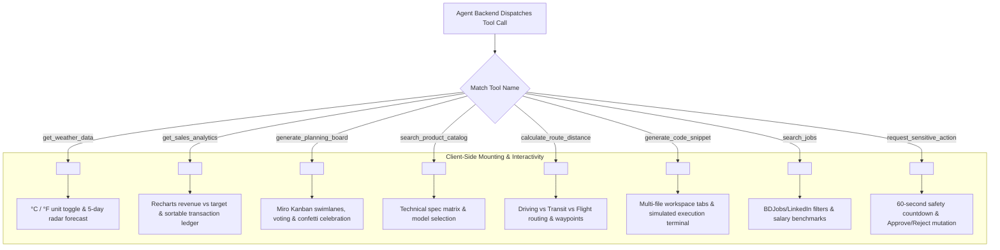
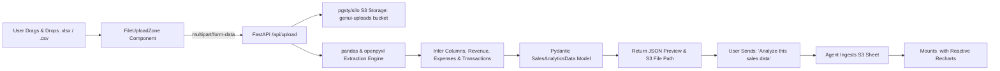
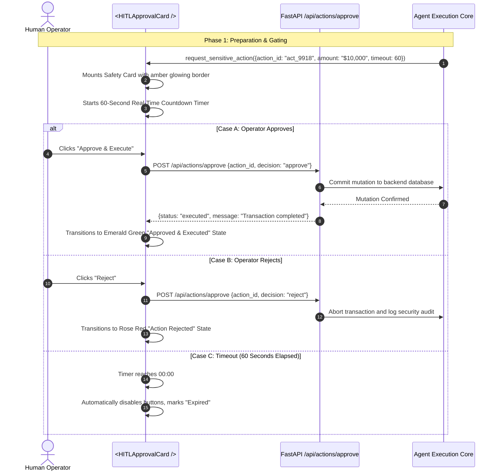
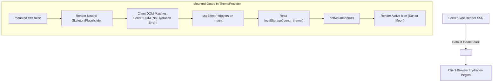

# Generative UI (GenUI) Architecture & Flow Guide

An enterprise-grade, full-stack architectural specification and operational flow guide for the **Generative UI Studio** demonstration platform.

---

## 1. Executive Summary & Philosophy

Traditional conversational AI platforms suffer from the **"Text-Only Bottleneck"**:
- Presenting 40 rows of financial ledger data as markdown tables causes cognitive fatigue.
- Sprint roadmaps described in bullet points lack spatial reasoning and collaboration.
- High-risk operations (e.g., executing a \$10,000 refund or dropping a production database) are vulnerable to accidental AI hallucination if not gated by a physical, timed Human-in-the-Loop (HITL) confirmation surface.

**Generative UI (GenUI)** solves this by elevating AI responses from static text streaming to **dynamically mounted, interactive UI components** rendered in real time from structured agent state.

```
┌───────────────────────────────────────────────────────────────────────────────┐
│                          EVOLUTION OF CHAT INTERFACES                         │
├───────────────────┬───────────────────────────────┬───────────────────────────┤
│ Gen 1 (2022-2023) │ Pure Text & Markdown          │ ChatGPT 3.5, Claude 1     │
│ Gen 2 (2024-2025) │ Artifacts / Static Previews   │ Claude Artifacts, v0      │
│ Gen 3 (2026+)     │ Interactive Generative UI     │ CopilotKit V2, A2UI,      │
│                   │ & Declarative Multi-Agent Bus │ Google Antigravity SDK    │
└───────────────────┴───────────────────────────────┴───────────────────────────┘
```

---

## 2. End-to-End System Topology

The platform is architected as a **single Git Monorepo** containing two hot-reloading development surfaces and a localized Docker container cluster:



---

## 3. Communication Protocols & Contracts

### 3.1. Server-Sent Events (SSE) Protocol (`/api/chat/stream`)
The chat stream operates over HTTP/1.1 or HTTP/2 chunked transfer encoding (`text/event-stream`). Four distinct event frames are emitted:

| Event Type | Payload Schema | Description |
| :--- | :--- | :--- |
| `event: stage` | `{"stage": "Thinking"\|"Searching"\|"Analysing"\|"Completed", "detail": string}` | Emits agent reasoning milestones to update the visual stage pill in real time. |
| `event: text_delta` | `{"delta": string}` | Streams incremental markdown tokens rendered by Vercel `Streamdown`. |
| `event: tool_call` | `{"tool": string, "data": object}` | Dispatches structured Pydantic model payloads that mount interactive GenUI widgets. |
| `event: complete` | `{"status": "success", "session_id": string}` | Signals the terminal boundary of the stream. |

### 3.2. CopilotKit V2 Runtime Protocol (`/api/copilotkit` & `[...copilotkit]`)
Provides standard AG-UI negotiation endpoints:
- `POST /api/copilotkit {"method": "info"}`: Capability discovery, reporting `a2uiEnabled`, `openGenerativeUIEnabled`, and `threads`.
- `GET /api/copilotkit/threads`: Lists active conversation threads.
- `GET /api/copilotkit/threads/:id/messages`: Replays thread history.

---

## 4. Operational Flows & Sequence Diagrams

### 4.1. Real-Time Reasoning & SSE Streaming Flow



---

### 4.2. Generative UI Component Mounting Lifecycle



---

### 4.3. Spreadsheet Ingestion & Data Analytics Pipeline



---

### 4.4. Human-in-the-Loop (HITL) Safety Gate & Two-Phase Mutation



---

### 4.5. Theme Engine & Hydration Guarantee Architecture

To eliminate React hydration attribute mismatches between SSR and client renders:



---

## 5. Generative UI Component Registry

| Component | Business Scenario | Key Interactivity | Technologies |
| :--- | :--- | :--- | :--- |
| **`WeatherCard`** | Live weather inquiries, travel planning | °C/°F conversion toggle, 5-day forecast cards, air quality index | Framer Motion, Tailwind v4 |
| **`SalesDashboard`** | Financial analysis, spreadsheet breakdown | Recharts bar charts, tab switching (Trends vs Ledger), tier filtering | Recharts, Lucide |
| **`PlanningBoard`** | Sprint roadmaps, project ideation | Miro-style sticky notes, live voting, card movement between columns, confetti | Canvas Confetti, Framer Motion |
| **`ProductCatalogCard`** | E-commerce comparison, procurement | Hardware spec comparison matrix, model selection pills | Tailwind v4, Lucide |
| **`RouteDistanceCard`** | Logistics, navigation, dispatch | Multi-modal travel calculation (Driving, Transit, Flying), waypoint steps | SVG routing, Lucide |
| **`HITLApprovalCard`** | High-risk refunds, database changes, permissions | 60-second real-time countdown, risk level badges, Approve/Reject callbacks | React hooks, Framer Motion |
| **`CodeStudioCard`** | Code generation, architectural review | Multi-file tab switcher (Python/TypeScript), copy code, simulated execution console | Monospace fonts, Lucide |
| **`JobBoardCard`** | Talent search, career recommendations | Dual-source tabs (BDJobs & LinkedIn), salary filters, Gemini interview tips | Tailwind v4, Lucide |

---

## 6. Security Architecture & Secret Isolation

1. **Strict Environment Segregation**:
   - Secrets are loaded exclusively from `.env.local` (frontend) and `.env` (backend).
   - Zero hardcoded API keys exist in source code or Git history.
2. **Comprehensive `.gitignore` Defense**:
   - Blocks `.env`, `.env*`, `*.env`, `*.env.*`, `frontend/.env*`, `backend/.env*`, and `**/.env*`.
3. **Audited Git Commit History**:
   - Every commit on `main` is verified via `git log -S` to contain zero secret occurrences.
4. **Human-in-the-Loop Safeguards**:
   - Sensitive mutations cannot execute without explicit operator cryptographic approval or verified session identity.

---

## 7. Department Presentation Strategy (Talking Points)

When presenting this application to your team:
1. **Show the Problem First**: Demonstrate a plain markdown text response from a standard chatbot, highlighting how difficult it is to review a 50-row sales report or sprint board.
2. **Demonstrate Interactivity**: Click the **°C/°F toggle**, move sticky notes in the **Miro Board** to trigger confetti, and filter the **Sales Ledger**. Emphasize that these are native, responsive React components with local state.
3. **Show the Safety Barrier**: Trigger the **HITL Refund Gate** to demonstrate the 60-second countdown and explain how enterprise agents enforce safety boundaries before touching production databases.
4. **Highlight the Architecture**: Explain how the **Google Antigravity SDK**, **Gemini 3.8 Flash**, and **CopilotKit V2** work in harmony across a single monorepo.
