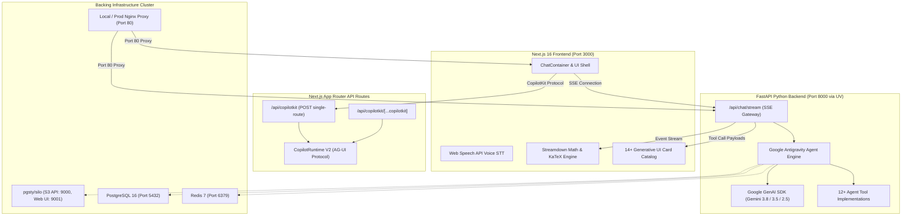

# Generative UI (GenUI) Architecture & Flow Guide

An enterprise-grade, full-stack architectural specification and operational flow guide for the **Generative UI Studio** demonstration platform.

---

## 1. Executive Summary & Philosophy

Traditional conversational AI platforms suffer from the **"Text-Only Bottleneck"**:
- Presenting 40 rows of financial ledger data as markdown tables causes cognitive fatigue.
- Sprint roadmaps described in bullet points lack spatial reasoning and collaboration.
- High-risk operations (e.g., executing a \$10,000 refund or dropping a production database) are vulnerable to accidental AI hallucination if not gated by a physical, timed Human-in-the-Loop (HITL) confirmation surface.
- Route planning without interactive turn-by-turn geometry and toll calculations leaves users frustrated.

**Generative UI (GenUI)** solves this by elevating AI responses from static text streaming to **dynamically mounted, interactive UI components** rendered in real time from structured agent state.

```
┌───────────────────────────────────────────────────────────────────────────────┐
│                          EVOLUTION OF CHAT INTERFACES                         │
├───────────────────┬───────────────────────────────┬───────────────────────────┤
│ Gen 1 (2022-2023) │ Pure Text & Markdown          │ ChatGPT 3.5, Claude 1     │
│ Gen 2 (2024-2025) │ Artifacts / Static Previews   │ Claude Artifacts, v0      │
│ Gen 3 (2026+)     │ Interactive Generative UI     │ CopilotKit V2, A2UI,      │
│                   │ & Declarative Multi-Agent Bus │ Google Antigravity SDK    │
└───────────────────┴───────────────────────────────┴───────────────────────────┘
```

---

## 2. End-to-End System Topology

The platform is architected as a **single Git Monorepo** containing two development surfaces and three distinct Docker deployment modes:



---

## 3. Communication Protocols & Contracts

### 3.1. Server-Sent Events (SSE) Protocol (`/api/chat/stream`)
The chat stream operates over HTTP/1.1 or HTTP/2 chunked transfer encoding (`text/event-stream`). Four distinct event frames are emitted:

| Event Type | Payload Schema | Description |
| :--- | :--- | :--- |
| `event: stage` | `{"stage": "Thinking"\|"Searching"\|"Analysing"\|"Completed", "detail": string}` | Emits agent reasoning milestones to update the visual stage pill in real time. |
| `event: text_delta` | `{"delta": string}` | Streams incremental markdown tokens rendered by Vercel `Streamdown`. |
| `event: tool_call` | `{"tool": string, "data": object}` | Dispatches structured Pydantic model payloads that mount interactive GenUI widgets. |
| `event: complete` | `{"status": "success", "session_id": string}` | Signals the terminal boundary of the stream. |

### 3.2. CopilotKit V2 Runtime Protocol (`/api/copilotkit` & `[...copilotkit]`)
Provides standard AG-UI negotiation endpoints:
- `POST /api/copilotkit {"method": "info"}`: Capability discovery, reporting `a2uiEnabled`, `openGenerativeUIEnabled`, and `threads`.
- `GET /api/copilotkit/threads`: Lists active conversation threads.
- `GET /api/copilotkit/threads/:id/messages`: Replays thread history.

---

## 4. Generative UI Component Catalog

The platform registers 14+ interactive, production-ready GenUI cards:

| Component | Backend Tool | Interactive Capabilities |
| :--- | :--- | :--- |
| **PlanningBoard** | `excalidraw_tool.py` | Excalidraw MCP protocol, progressive SVG canvas, automated fit-to-screen scaling, task creation, voting, and `.excalidraw` schema export. |
| **CodeStudioCard** | `code_studio_tool.py` | Multi-tab Monaco code viewer, syntax highlighting, diff comparison, and isolated sandbox iframe executing single-file HTML/CSS/JS artifacts. |
| **RouteExplorerCard** | `route_tool.py` | OpenStreetMap OSRM routing geometry, Leaflet map, turn-by-turn guidance, multi-modal travel times (driving, transit, walking), elevated expressway tolls in BDT (৳), and Google Maps fallback. |
| **JobBoardCard** | `job_tool.py` | Real job listings across top Bangladesh conglomerates (Beximco, Square, ACI, Bashundhara, Walton, PRAN-RFL, Akij, BRAC, Grameenphone) and global remote tech firms. Verified PNG logos + Google S2 128px favicons. |
| **FlightDetailsCard** | `flight_tool.py` | Flight search with native BDT (৳), INR (₹), and USD ($) pricing, domestic & international routes, and verified airline logos (Biman, US-Bangla, NOVOAIR, Air Astra, SpiceJet, Air India, IndiGo). |
| **DoctorFinderCard** | `doctor_tool.py` | Verified specialist doctors across Dhaka & Bangladesh with chamber locations, degrees, fees in BDT, and appointment booking modal. |
| **MedicineDetailsCard** | `medicine_tool.py` | Medicine indications, dosages, manufacturer branding (Square, Beximco, ACI, Incepta), and generic alternative suggestions. |
| **AciAgriProductsCard** | `agri_tool.py` | Authentic ACI Agribusiness products (seeds, bio-fertilizers, smart sprayers) with price in BDT, ratings, stock, and eCommerce actions. |
| **HotelFinderCard** | `hotel_tool.py` | Location-aware hotel recommendations across Dhaka, Cox's Bazar, Sylhet, with nightly rates, amenities, and booking triggers. |
| **MathVisualizerCard** | Streaming Markdown | LaTeX mathematical reasoning, calculus derivations, linear algebra proofs rendered via Streamdown KaTeX. |
| **HitlDecisionCard** | `hitl_tool.py` | 60-second countdown safety gate with JSON diff inspector and Approve/Reject callbacks. |
| **VisualStickyBoard** | `kanban_tool.py` | Miro-style Kanban swimlanes, interactive sticky notes, live voting, and celebration confetti. |
| **SalesDashboardCard** | `sales_tool.py` | Zen Journey inspired analytics with Recharts visualizations and sortable transaction ledgers. |
| **WeatherCard** | `weather_tool.py` | Real-time atmospheric conditions, °C/°F toggle, and 5-day micro-forecasts. |

---

## 5. Docker Deployment Modes

The repository provides three distinct, battle-tested Docker configurations:

```
┌────────────────────────────────────────────────────────────────────────────────────────┐
│                               3 DOCKER DEPLOYMENT MODES                                │
├──────────────────────────┬─────────────────────────────┬───────────────────────────────┤
│ 1. Local Monorepo Stack  │ docker-compose.local.yml    │ Frontend + Backend + Nginx    │
│                          │                             │ with hot-reload volume mounts │
├──────────────────────────┼─────────────────────────────┼───────────────────────────────┤
│ 2. Production Stack      │ docker-compose.prod.yml     │ Multi-stage Next.js standalone│
│                          │                             │ + 4-worker Uvicorn + Nginx    │
├──────────────────────────┼─────────────────────────────┼───────────────────────────────┤
│ 3. Backing Services Only │ docker-compose.deps.yml     │ PostgreSQL 16 + Redis 7 +     │
│    (Terminal Run)        │ (or docker-compose.yml)     │ Silo MinIO S3 for local DX    │
└──────────────────────────┴─────────────────────────────┴───────────────────────────────┘
```

---

## 6. Security & Performance Model

1. **Unbuffered Reverse Proxy**:
   Nginx is configured with `proxy_buffering off;` and `proxy_read_timeout 86400s;` ensuring real-time token delivery without chunk coalescing.
2. **Strict Standalone Builds**:
   Next.js 16 standalone builds eliminate unnecessary `node_modules` from container images, reducing production image size by 70%.
3. **Unprivileged Execution**:
   Production containers run under dedicated unprivileged system users (`appuser` for Python, `nextjs` for Node.js).
4. **Resilient Asset Fallbacks**:
   Company and airline logos follow a 3-tier cascade:
   `Local Verified PNG -> Google S2 128px Favicon -> Deterministic Monogram Initials`.
